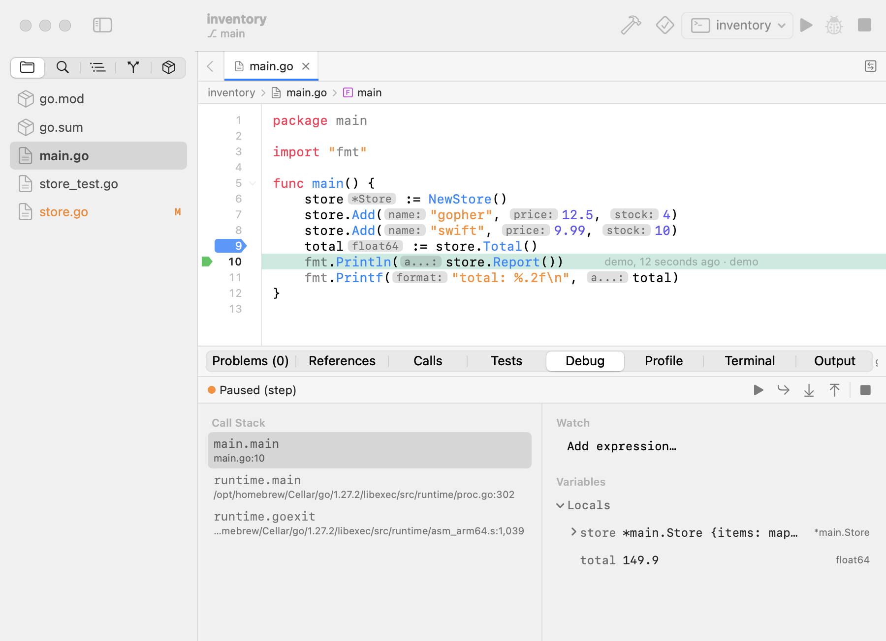
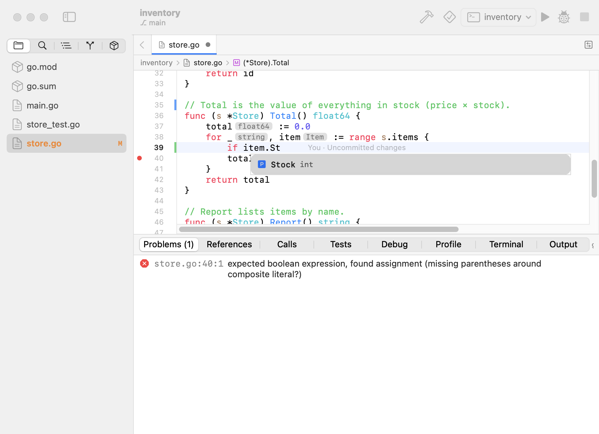
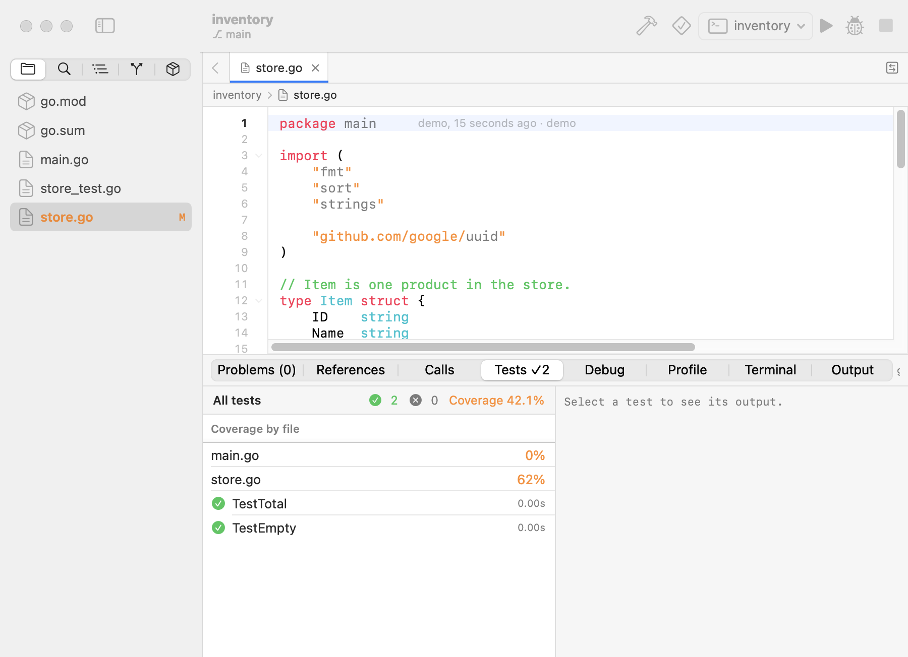
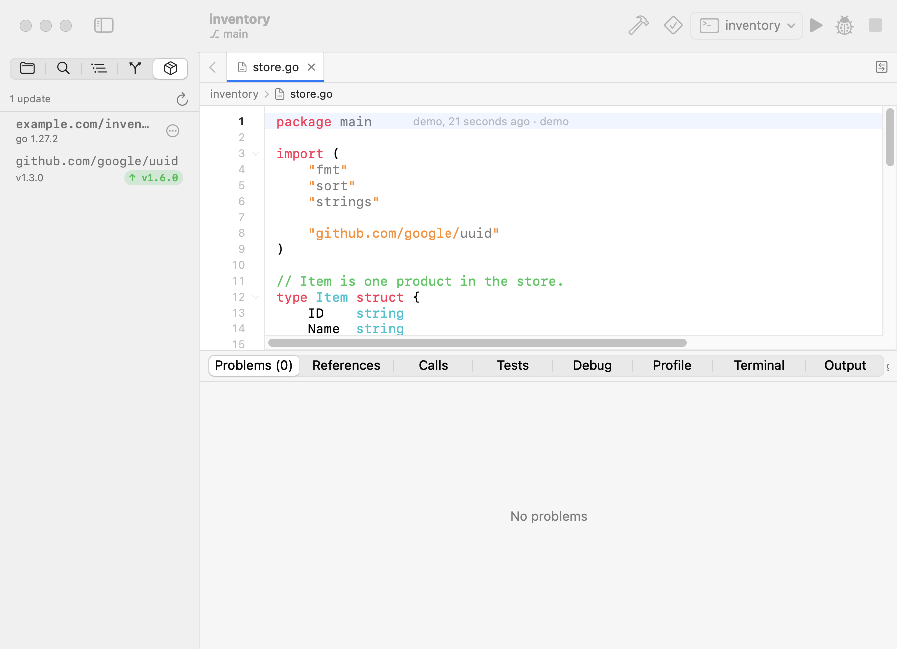
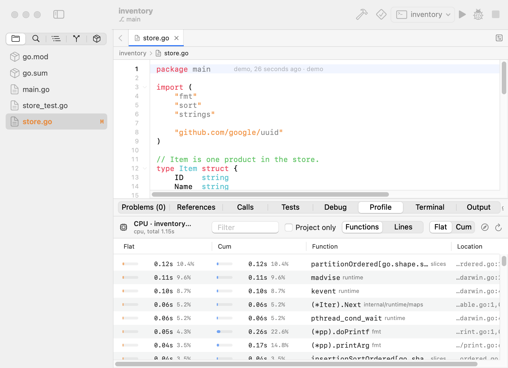
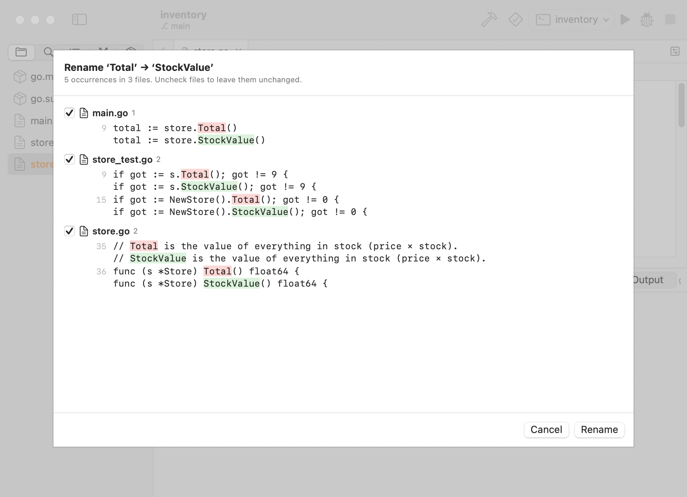

# GoIDE

[](https://github.com/lai3d/golang-ide/actions/workflows/ci.yml)

A native macOS IDE for Go, written in Swift (SwiftUI + AppKit).

> Early but usable: editing, navigation, refactoring, testing, debugging and profiling for Go modules.



| | |
|---|---|
|  <br> Completion, inlay hints, Git change bars |  <br> Tests panel with coverage |
|  <br> Dependencies and available updates |  <br> CPU / memory profiling (pprof) |
|  <br> Rename preview across files | |

Screenshots are generated with `scripts/screenshots.sh` (GoIDE's `--snapshot` mode).

## Features

**Editor**
- Tabs with independent buffers, undo and scroll; unsaved-changes prompts
- Go syntax highlighting refined by gopls semantic tokens; inlay hints for parameter names and inferred types
- Line-number gutter with error/warning markers, Git change bars and code folding (⌥⌘← / ⌥⌘→)
- Occurrence highlights for the symbol under the caret; current-line highlight, auto-indent
- Auto-closing brackets and quotes, toggle comment (⌘/), move / duplicate lines, indent / outdent
- Snippets: gopls call placeholders and built-ins (`iferr`, `fori`, `forr`, `tt`, …) with Tab stops
- Breadcrumbs (folder › file › type › function) above the editor
- Format on save (gofmt + organize imports via gopls), Format Document (⌥⇧F)

**Project**
- Sidebar file tree that follows changes on disk (FSEvents); new/rename/trash from the context menu
- Open files reload when changed externally (or offer Reload / Keep Mine if you have edits)
- Find in project (⇧⌘F): match case, whole word, regex
- Open Quickly (⌘P / ⇧⌘O): fuzzy file finder + workspace symbols; Outline sidebar for the current file
- Git: status badges in the sidebar, branch in the title bar, inline blame for the caret line
- Multiple windows, one project each (⇧⌘N)
- Integrated terminal (⌃`) running your login shell in the project folder
- Dependencies sidebar (⌃⇧M): every `go.mod` (and `go.work` members) with direct / indirect requirements, replacements and available updates; upgrade one or all, tidy, `go mod why`; create a `go.work` for multi-module folders

**Language (gopls)**
- Live diagnostics: underlines, gutter dots, Problems panel
- Completion with auto-imports, hover docs, signature help while typing calls
- Jump to definition (⌘-click / ⌃⌘J), implementation (⌥⌘J), type definition (⌃⌥⌘J) and back (⌃⌘←); find references (⇧⌘R), call hierarchy (⌃⌥H)
- Rename symbol across files (⌃⌘E) with an optional preview of every changed line; quick fixes and refactorings (⌥↩)
- Refactor menu: Extract Function (⌥⌘M) / Method / Variable (⌥⌘V) / Constant, Inline Call (⌥⌘N) / Variable
- Settings ▸ Go: gofumpt, local import prefix, staticcheck, shadow analyzer, build tags (applied live)

**Run, test & debug**
- Run configurations (main package, arguments, environment) for Run (⌘R) and Debug; `go build ./...` (⌘B), stop (⌘.)
- Test coverage (⌃⇧⌘U): covered / uncovered lines tinted, per-file percentages
- Tests via `go test -json` (⌘U all, ⌃⌘U package, ⌃⌥⌘U at cursor): Tests panel, gutter ▶ / ✓ / ✗
- Profiling (Go ▸ Profile, ⌃⌥⌘P): CPU / memory pprof of a package's benchmarks or tests, top functions or lines, jump to source, open the pprof web UI
- Debugger (Delve DAP, ⌥⌘R): click line numbers for breakpoints, continue / step over (F6) / into (F7) / out (F8), call stack, expandable variables; debug a single test

See [ROADMAP.md](ROADMAP.md) for what's next.

## Requirements

- macOS 14+
- Swift 6 toolchain (Xcode 16 or later)
- Go, plus gopls and Delve:
  `go install golang.org/x/tools/gopls@latest`
  `go install github.com/go-delve/delve/cmd/dlv@latest`

GoIDE looks for `go`, `gopls` and `dlv` on `PATH`, `$GOBIN`, `$GOPATH/bin`, `~/go/bin`, `/opt/homebrew/bin` and `/usr/local/go/bin`, so it works when launched from Finder too.

## Install

Download `GoIDE.zip` from [Releases](https://github.com/lai3d/golang-ide/releases), unzip, and move
`GoIDE.app` to Applications. Builds are ad-hoc signed (not notarized), so the first time
right-click the app and choose **Open** (or run `xattr -dr com.apple.quarantine GoIDE.app`).

## Build & run

```sh
swift run GoIDE Examples/hello     # run in debug, opening the example project
swift test                         # unit tests + a gopls end-to-end test
./scripts/bundle.sh                # build build/GoIDE.app + GoIDE.zip (release, ad-hoc signed)
open build/GoIDE.app
```

You can also open `Package.swift` in Xcode.

## Layout

| Path | What |
|---|---|
| `Sources/GoIDECore` | UI-independent core: JSON-RPC/LSP client, message framing, Go highlighter, LSP position math, file tree |
| `Sources/GoIDE` | SwiftUI app: workspace state, editor view, sidebar, panels |
| `Tests/GoIDECoreTests` | swift-testing tests |
| `Examples/hello` | Small Go module for trying things out |
| `scripts/` | `bundle.sh` (app bundle), `make-icon.swift` (regenerates `Resources/AppIcon.icns`) |
| `.github/workflows/` | CI (build, test, bundle) and tagged releases (`v*` → GitHub Release) |


## Dependencies

- [SwiftTerm](https://github.com/migueldeicaza/SwiftTerm) 1.11.2 (MIT) — terminal emulation for the Terminal panel.
  Pinned before 1.12, whose Metal renderer needs Xcode's separately downloaded Metal toolchain.

## License

MIT — see [LICENSE](LICENSE).

## Releasing

Push a tag like `v0.2.0`; the Release workflow builds `GoIDE.zip` and attaches it to a GitHub
release. To ship a build that opens without Gatekeeper warnings you need, outside this repo:
an Apple Developer Program membership, a Developer ID Application certificate, and notarization
(`xcrun notarytool`) — then sign with that identity instead of `-` in `scripts/bundle.sh`.
